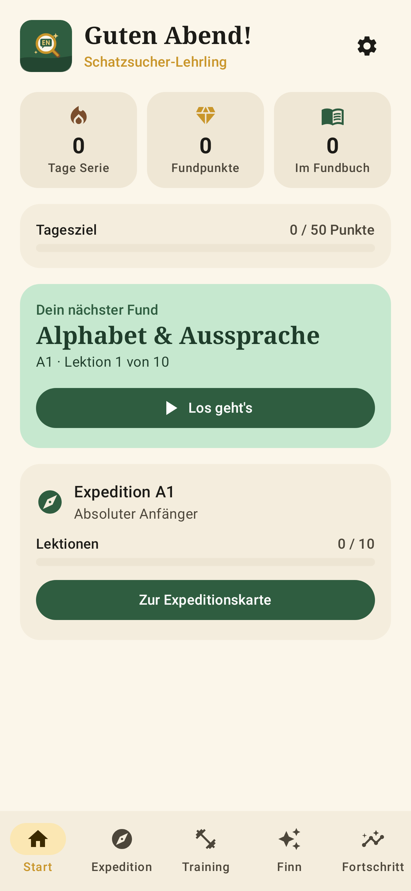
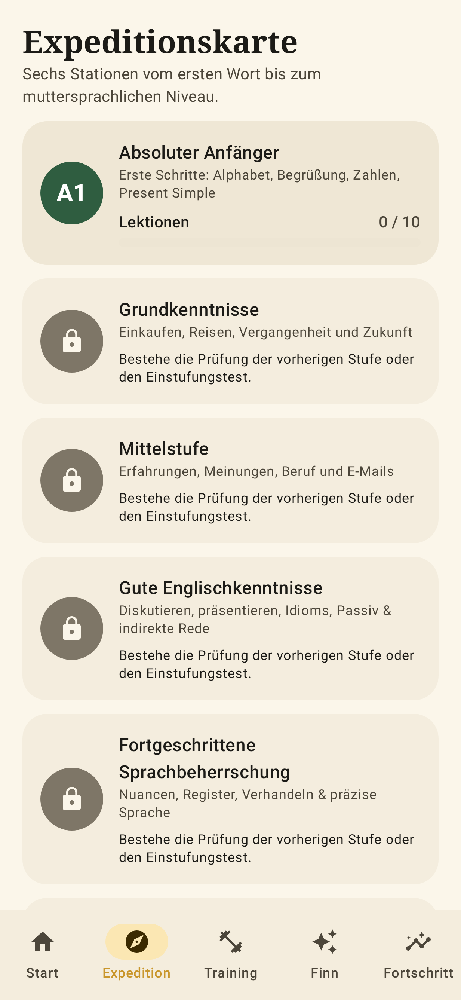
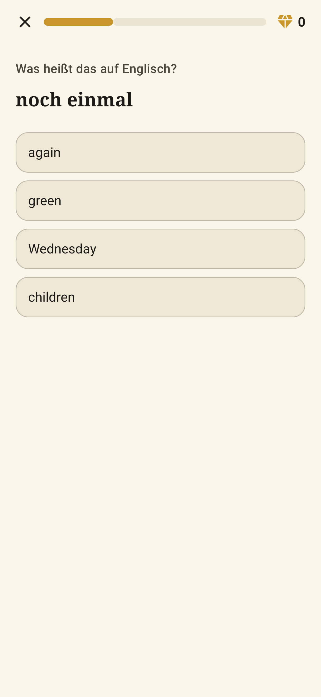

<p align="center"></p>

# Fundbrüder English – Englisch lernen von A1 bis C2

Eine native Android-App, mit der deutschsprachige Lernende selbstständig Englisch lernen – vom ersten Wort bis zum nahezu muttersprachlichen Niveau. Kostenlos, werbefrei, ohne Konto und größtenteils **offline**.

## ⬇️ Download

**[FundbruederEnglish.apk herunterladen](https://github.com/Schnielz87/Englisch-Lern-AppAPK/releases/latest/download/FundbruederEnglish.apk)**

> Hinweis: Solange das Repository **privat** ist, funktioniert der Link nur, wenn du im Handy-Browser bei GitHub angemeldet bist, und die Update-Prüfung in der App findet keine neuen Versionen. Wird das Repository öffentlich gestellt, funktioniert beides für alle.

Installation auf dem Handy:
1. Link auf dem Android-Handy öffnen – die APK wird heruntergeladen.
2. Datei öffnen. Beim ersten Mal fragt Android, ob der Browser „Apps aus unbekannten Quellen“ installieren darf → erlauben.
3. „Installieren“ tippen. Fertig.

Updates: In der App unter **Einstellungen → App-Aktualisierung** nach neuen Versionen suchen. Der Lernfortschritt bleibt bei Updates erhalten.

Voraussetzung: Android 8.0 (API 26) oder neuer.

<p align="center">
  
</p>

## Funktionen

**Lernweg in sechs Stufen (GER/CEFR)** – die „Expedition“
| Stufe | Inhalte |
|---|---|
| A1 Absoluter Anfänger | Alphabet & Aussprache, Begrüßungen, sich vorstellen („to be“), Zahlen, Uhrzeit & Datum, Farben & Artikel, Familie, Fragen, Present Simple, Satzbau |
| A2 Grundkenntnisse | Einkaufen, Restaurant, Reisen, Wegbeschreibungen, Past Simple, unregelmäßige Verben, Zukunft, Telefonieren |
| B1 Mittelstufe | Gespräche führen, Beruf, Present Perfect, Present Perfect vs. Past, Meinungen, Conditionals, komplexe Sätze, E-Mails |
| B2 Gute Kenntnisse | Flüssig sprechen, Argumentieren, Präsentationen, komplexe Texte, Idioms, Passiv, indirekte Rede, Past Perfect/Third Conditional/wish, Phrasal Verbs |
| C1 Fortgeschritten | Hedging & Nuancen, Fachdiskussionen, Verhandeln, Sprachregister, Kollokationen, Business-Idioms, Inversion & Cleft Sentences, STAR-Antworten |
| C2 Nahezu muttersprachlich | Konnotation, Mehrdeutigkeit & Wortspiele, Ironie & Understatement, Stilmittel, komplexe Argumentation & Denkfehler, kulturelle Varietäten, Textanalyse |

**Jede Lektion** enthält deutsche Erklärungen mit Beispielen, Vokabelkarten mit Sprachausgabe und abwechslungsreiche Übungen: Multiple Choice, Lückentexte, Übersetzen, Satzbau, Hörverstehen, Diktat, Aussprache (Spracherkennung) und Rollenspiel-Dialoge.

**Passt sich an:** Wer sicher ist, bekommt mehr freie Eingaben; wer Mühe hat, mehr Wiedererkennung. Fehler und fällige Vokabeln werden automatisch in spätere Lektionen eingestreut.

**Prüfungen:** Einstufungstest beim Start (adaptiv, Stufe für Stufe), Abschlussprüfung je Stufe (20 Aufgaben, ab 70 % bestanden → nächste Stufe + Zertifikat).

**Training:** Fundbuch (Vokabel-Wiederholung nach Leitner-System), Schwachstellen-Training, Hörtraining, Aussprache-Training, Gesprächstrainer.

**Motivation:** Fundpunkte, Expeditions-Ränge, Tagesziel, Lernserie, „Schatzkammer“ mit Erfolgen, Statistik, tägliche Erinnerung.

**Finn – der KI-Tutor (optional, online):**
- *Frag Finn* – Fragen zu Grammatik, Wörtern, Aussprache und zum Lernen, Antworten auf Deutsch
- *Gesprächspartner* – freie Rollenspiele (Restaurant, Arzt, Vorstellungsgespräch, Business-Meeting …) auf deinem Niveau, sprechen oder tippen, mit Korrektur nach jeder Antwort
- *Schreibtrainer* – Texte und E-Mails korrigieren lassen, mit Erklärungen und Niveau-Einschätzung
- *Lernberater* – Analyse deines Fortschritts und persönlicher 7-Tage-Plan
- *„Warum?“* – nach einem Fehler in einer Übung erklärt Finn die Regel

KI-Anbieter (in den Einstellungen wählbar):
- **Mit ChatGPT anmelden** – nutzt dein ChatGPT-Plus/Pro-Abo, kein API-Schlüssel nötig (umgesetzt nach OpenAIs „Sign in with ChatGPT“ für Open-Source-Apps; die Funktion ist bei OpenAI noch in der Vorschauphase).
- **Google Gemini** – eigener API-Schlüssel von [aistudio.google.com](https://aistudio.google.com/apikey), mit kostenlosem Kontingent.
- **OpenAI API** oder **Anthropic Claude** – eigener API-Schlüssel (nutzungsbasierte Kosten).

Schlüssel und Tokens werden mit dem Android Keystore verschlüsselt gespeichert und gehen direkt an den gewählten Anbieter – es gibt keinen Zwischenserver. Die App funktioniert ohne KI vollständig.

**Datenschutz:** Alle Lerndaten bleiben auf dem Gerät. Kein Konto, kein Tracking. Fortschritt lässt sich als Datei sichern und wiederherstellen.

## Technik

- Kotlin, Jetpack Compose, Material Design 3
- MVVM, manuelle Dependency Injection (`AppContainer`)
- Room (Fortschritt, Vokabelkarten, Statistik), DataStore (Einstellungen), WorkManager (Erinnerungen)
- Android TextToSpeech, SpeechRecognizer (bevorzugt On-Device/offline)
- OkHttp (HTTPS) für Update-Prüfung und KI
- Lerninhalte als JSON in `app/src/main/assets/content/` – unabhängig vom Code erweiterbar
- GitHub Actions: Tests, signierte Release-APK, automatisches GitHub-Release

```
app/src/main/java/de/englischlernen/app/
├── ai/            KI-Anbieter, ChatGPT-Anmeldung, Prompts, verschlüsselter Speicher
├── data/          Inhalte (JSON), Room-Datenbank, Einstellungen, Fortschritt, Sicherung
├── domain/        Übungsgenerator, Antwortprüfung, Leitner-System, Punkte & Erfolge
├── speech/        Sprachausgabe und Spracherkennung
├── ui/            Compose-Oberfläche (Screens, Lernsitzung, KI-Chat, Theme)
├── update/        Update-Prüfung über GitHub-Releases
└── work/          Tägliche Erinnerung
```

## Selbst bauen

Voraussetzungen: JDK 21, Android SDK (Plattform 37).

```bash
./gradlew testDebugUnitTest   # Tests (inkl. Prüfung aller Lerninhalte + UI-Screenshots)
./gradlew assembleRelease     # APK: app/build/outputs/apk/release/app-release.apk
```

## Inhalte erweitern

Jede Stufe ist eine Datei `app/src/main/assets/content/<stufe>.json`. Eine Lektion besteht aus `theory`, `vocab`, `sentences`, `quiz`, `gaps` (Lückentext mit genau einem `___`) und optional `dialogue`. Die Übungen erzeugt die App automatisch daraus. Der Test `ContentValidationTest` prüft beim Build alle Inhalte (z. B. doppelte Antwortoptionen, falsche Antwortindizes).

## Neue Version veröffentlichen

1. In `app/build.gradle.kts` `appVersionCode` um 1 erhöhen und `appVersionName` anpassen (z. B. `1.1.0`).
2. Committen und pushen. GitHub Actions baut, testet und veröffentlicht automatisch das Release `v1.1.0` mit `FundbruederEnglish.apk`.
3. Der Download-Link oben zeigt immer auf die neueste Version.

## Signatur (wichtig für sichere Updates)

Android installiert Updates nur, wenn sie mit demselben Schlüssel signiert sind. Damit die App sofort installierbar ist, liegt ein **öffentlicher Übergangs-Schlüssel** in `signing/fallback-release.jks`. Solange das Repository privat ist, ist das unkritisch. Wird es öffentlich, könnte ihn theoretisch jeder verwenden – spätestens dann solltest du einen eigenen, geheimen Schlüssel hinterlegen:

```bash
keytool -genkeypair -v -keystore release.jks -storetype PKCS12 -alias fundbrueder \
  -keyalg RSA -keysize 4096 -validity 10000
base64 -w0 release.jks   # Ausgabe kopieren
```

Unter *GitHub → Settings → Secrets and variables → Actions* anlegen:
`SIGNING_KEYSTORE_BASE64` (die base64-Ausgabe), `SIGNING_KEYSTORE_PASSWORD`, `SIGNING_KEY_ALIAS` (`fundbrueder`), `SIGNING_KEY_PASSWORD`.

Ab dann signiert die Pipeline mit deinem eigenen Schlüssel. **Einmalig** muss die App dafür deinstalliert und neu installiert werden – vorher in der App unter *Einstellungen → Sicherung → Exportieren* den Fortschritt sichern und danach wieder importieren. Den Schlüssel gut aufbewahren: Geht er verloren, sind keine Updates mehr möglich.

